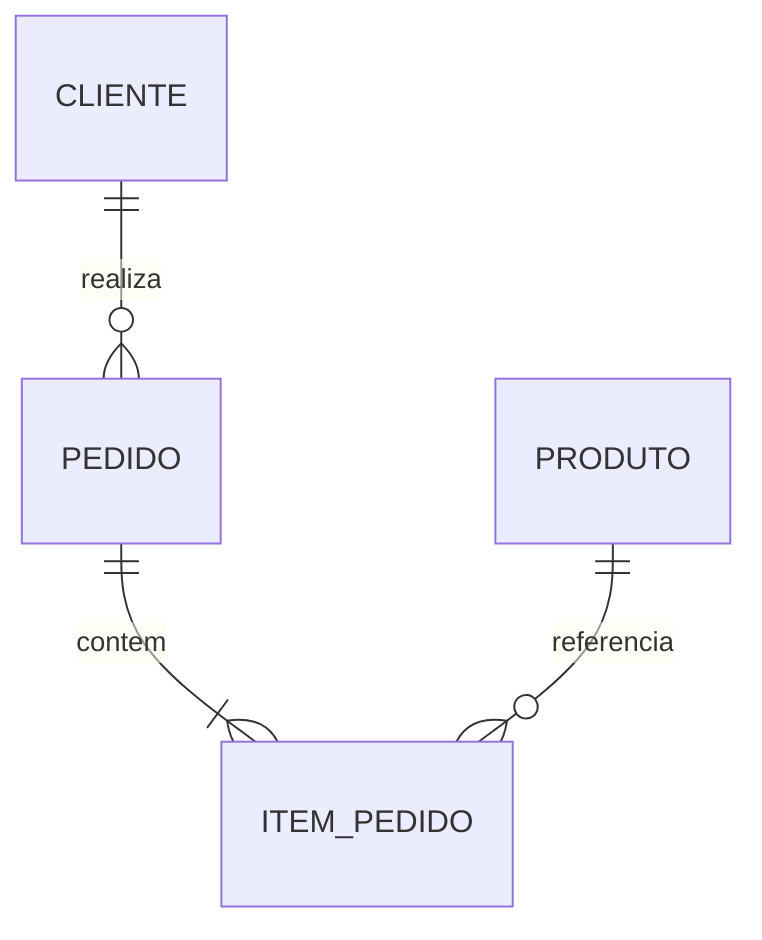

> Atualização: execução real concluída; consulte [RESULTADOS_REAIS.md](RESULTADOS_REAIS.md) para resultados, variantes e limitações. Qualquer pendência de execução abaixo pertence ao planejamento inicial.

# Dados, modelos e protocolo experimental

## 1. Continuidade dos documentos anteriores

O primeiro material apresenta o paradigma orientado a documentos e o MongoDB. O segundo propõe um cenário de pedidos e vendas, PostgreSQL versus MongoDB, com os itens incorporados ao pedido no modelo documental. A implementação usa esse cenário para investigar uma consequência prática da modelagem: ler um agregado de pedido completo em um documento versus reconstruí-lo no modelo relacional.

A fundamentação não substitui a prova experimental. Casos de empresas citados na pesquisa teórica não demonstram que este experimento será mais rápido em MongoDB.

## 2. Registro lógico e geração

**Um registro lógico é um pedido completo**, composto por cabeçalho e de 1 a 10 itens. O mínimo de um milhão refere-se a pedidos, não à soma artificial de clientes, produtos e itens. A quantidade física de linhas no PostgreSQL será maior que a quantidade de documentos de pedidos; isso é consequência das modelagens, não diferença na massa lógica.

A geração é sintética e reproduzível, com semente 42, 10.000 clientes e 1.000 produtos. As datas pertencem ao ano de 2025 e são interpretadas em UTC. Não são usados dados pessoais reais. Cada item registra produto, quantidade e preço unitário histórico; alterações futuras no catálogo não devem alterar a receita de pedidos antigos.

### Convenções

- Identificadores estáveis e correspondentes nos dois bancos.
- Valores monetários em **centavos inteiros**, evitando diferenças de ponto flutuante.
- Estados: `criado`, `concluido` e `cancelado`.
- Indicadores de vendas consideram somente pedidos `concluido`.
- Filtro temporal com início inclusivo e fim exclusivo: `[início, fim)`.
- Período padrão: de `2025-01-01` até, mas sem incluir, `2026-01-01`.
- A ordem dos itens precisa ser preservada para comparar o pedido completo.
- Totais de pedidos devem corresponder à soma de `quantidade × preço_unitário_centavos` de seus itens.

O relatório de carga deve registrar o volume efetivamente gerado, os itens, os clientes e os produtos, a semente, o intervalo temporal, os arquivos de entrada e a evidência de que a mesma massa foi usada nos dois destinos.

## 3. Modelos

### Relacional



Entidades: cliente, produto, pedido e item do pedido. As chaves estrangeiras preservam as referências. Os itens mantêm a quantidade e o preço histórico. A consulta de pedido completo precisa reconstruir o conjunto de cabeçalho e itens.

### Documental

```text
clientes: { id, ... }
produtos: { id, ... }
pedidos: {
  id,
  cliente_id,
  data,
  status,
  itens: [{ posição, produto_id, quantidade, preço_unitário_centavos }, ...]
}
```

Os nomes acima descrevem o modelo conceitual; os nomes executáveis constam no código de carga e consultas. Os itens são incorporados ao pedido, enquanto clientes e catálogo são referenciados. O tamanho de cada pedido é limitado pela regra de 1–10 itens. Essa incorporação favorece a leitura do agregado, mas aumenta a importância de tratar atualizações e agregações sobre arrays corretamente.

## 4. Consultas equivalentes

### Q1 — Pedido completo por ID

Retorna o mesmo pedido e a mesma lista de itens, ordenados por posição. Um ID inexistente deve retornar ausência nos dois bancos. A comparação não pode medir apenas o cabeçalho no MongoDB e todos os itens no PostgreSQL, ou vice-versa.

### Q2 — Vendas diárias

Filtra pedidos concluídos no intervalo `[início, fim)`, agrupa por dia UTC e retorna dia, número de pedidos e receita em centavos. Ordena os dias em ordem crescente. Dias sem pedidos podem ser omitidos, desde que ambos os bancos usem a mesma regra.

### Q3 — Top 10 produtos

Filtra os mesmos pedidos concluídos e o mesmo período. Soma quantidade e receita por produto. Ordena por quantidade decrescente, depois receita decrescente e, por fim, ID do produto crescente, retornando no máximo dez produtos. O desempate evita divergências causadas apenas pela ordem de resultados empatados.

## 5. Comparação justa

1. Registrar sistema operacional, CPU, RAM, arquitetura, versões de Python/driver e versões dos dois bancos.
2. Usar a mesma máquina, massa, filtros e semântica; executar os bancos sem trabalhos concorrentes conhecidos.
3. Registrar índices realmente criados e planos de execução. Chaves primárias e índices de filtro não podem ser removidos apenas para favorecer o NoSQL.
4. Medir a carga separadamente das consultas. Informar se criação de índices está ou não incluída no tempo de carga.
5. Fazer aquecimento separado das repetições medidas. Explicar o estado do cache; aquecimento não equivale a cache frio.
6. Executar pelo menos 10 repetições medidas para cada consulta e banco; intercalar/alternar os bancos quando o executor permitir.
7. Medir a mesma fronteira nos dois bancos: executar e consumir integralmente o resultado. Registrar latência em milissegundos, sem confundi-la com tempo total de renderização da interface.
8. Preservar todos os tempos brutos. Usar a mediana como medida principal, acompanhada da dispersão. Não selecionar somente a melhor execução.
9. Validar os resultados retornados antes de interpretar qualquer ganho. Uma consulta incorreta ou incompleta não é uma otimização válida.
10. Repetir o experimento após qualquer mudança em modelo, índice, versão ou consulta, identificando cada rodada.

O benchmark só deve apresentar um fator de aceleração como `mediana_SQL / mediana_NoSQL` quando ambas as medianas forem válidas e positivas. Valor maior que 1 favorece MongoDB; menor que 1 favorece PostgreSQL. Pequenas diferenças dentro da variabilidade não sustentam uma conclusão forte.

### Protocolo implementado

O executor usa duas rodadas de aquecimento por consulta/banco e pelo menos dez repetições medidas, alternando qual banco executa primeiro. As conexões do benchmark são persistentes. Confere equivalência antes e durante as repetições; resultados vazios ou divergentes invalidam a rodada. O relatório registra mediana, mínimo, máximo e intervalo interquartil. O cronômetro inclui execução, consumo, normalização e serialização JSON do resultado, mas não a renderização da página.

O relatório de carga inclui versões e estatísticas dos bancos. CPU, RAM, arquitetura, versões exatas dos drivers, planos e demais condições que não forem coletados automaticamente devem ser preenchidos pelo executor. `pg_database_size` e os campos de `dbStats` não são automaticamente medidas equivalentes: distinguir dados, índices, armazenamento alocado e overhead antes de comparar.

## 6. Como argumentar sobre a vantagem NoSQL

A hipótese principal é Q1: a estrutura de documento permite ler o agregado de pedido com seus itens. Se os dados confirmarem ganho, relacioná-lo à incorporação e aos acessos necessários, apoiando a explicação com planos/estatísticas. Não prometer ganho para toda carga ou aplicação.

Se MongoDB não vencer, registrar o resultado, investigar se a consulta e os índices são adequados e refinar somente com justificativa de negócio. Registrar as mudanças e refazer ambos os lados. Não sabotar PostgreSQL, fabricar números nem trocar silenciosamente a pergunta. O requisito de mostrar uma vantagem continua pendente até ser demonstrado de forma válida.

## 7. Tamanho, integridade e limitações

Registrar tamanho dos arquivos de entrada, tamanho de dados e índices de cada banco e método usado para obter essas medidas. Bytes em disco e tamanho lógico não são a mesma métrica. Explicar compactação, overhead e índices antes de interpretar diferenças.

Comprovar pelo menos: contagem de pedidos, contagem de itens, ausência de IDs duplicados, referências válidas, totais monetários e resultados equivalentes das três consultas. Uma validação por amostragem deve ser identificada como amostragem, não como comprovação integral.

Limitações a discutir: dados sintéticos e sua distribuição, ambiente único, cache aquecido, latência do driver, volume testado, ausência de concorrência e escolha de modelagem. O experimento não representa automaticamente um sistema distribuído em produção.
